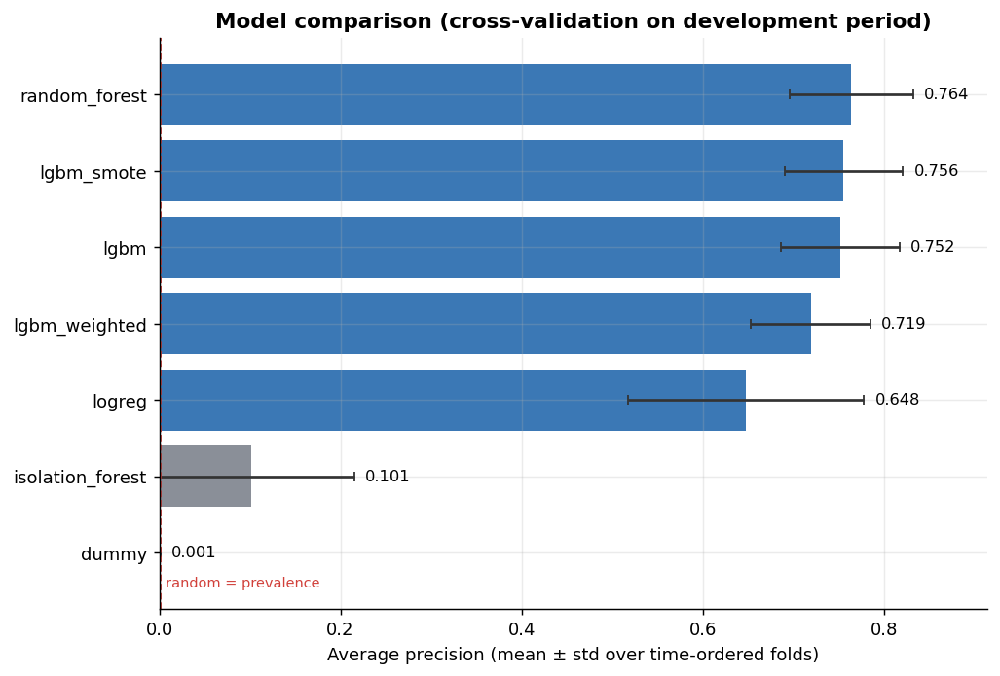
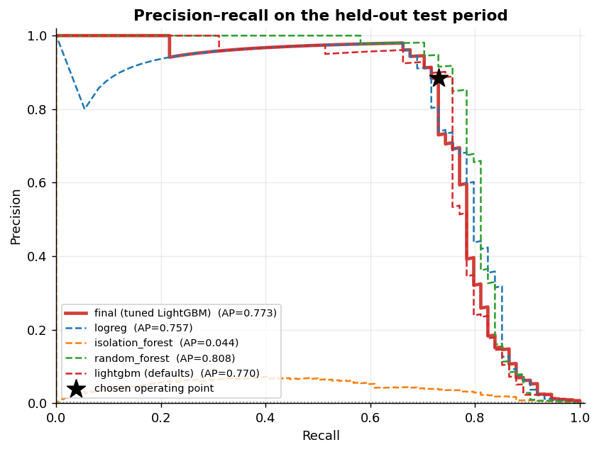
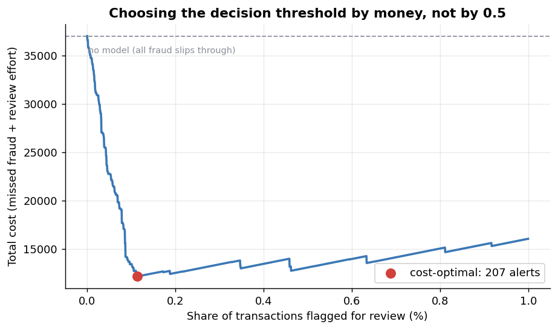
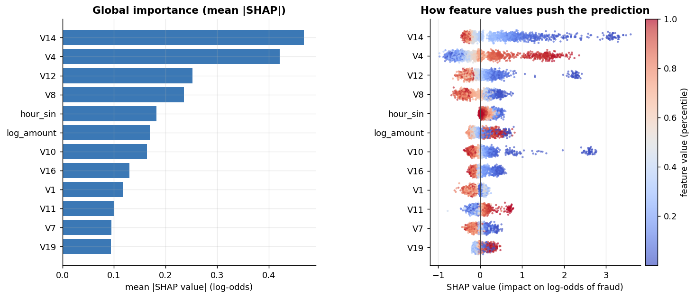
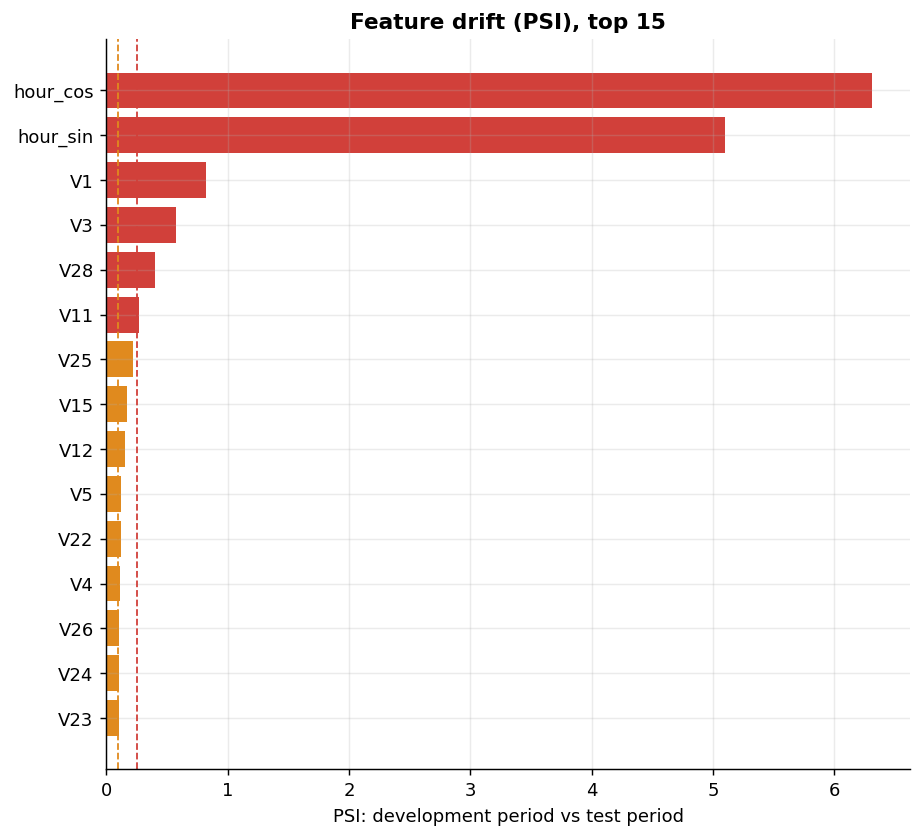
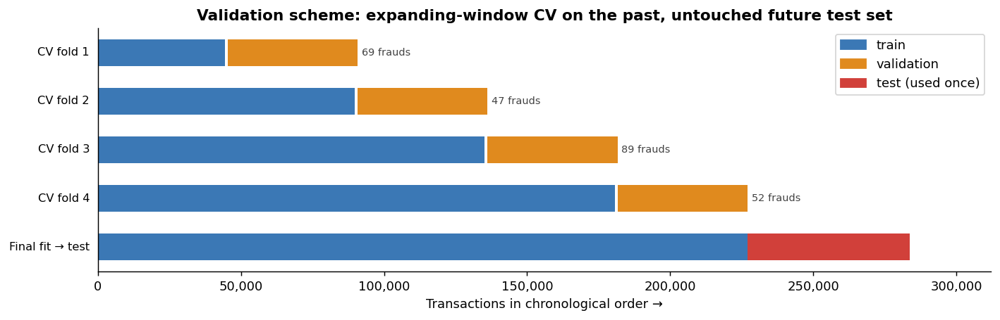
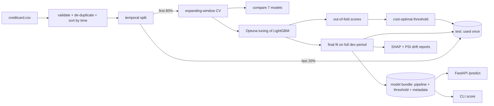

# Credit Card Fraud Detection: from notebook to a deployable service

An end-to-end machine learning project on a real, extremely imbalanced dataset (0.17% fraud).
It goes beyond "fit a model, print accuracy": the validation is time-aware and leakage-safe,
the decision threshold is chosen by money rather than by 0.5, predictions are explainable, drift
is monitored, and the trained model is served through a tested FastAPI application.

| | |
|---|---|
| **Problem** | Flag fraudulent card transactions for manual review |
| **Data** | 283,726 transactions (after de-duplication), 473 frauds, two days of European card traffic |
| **Main metric** | Average precision (PR-AUC). Accuracy is meaningless at a 0.17% base rate |
| **Final model** | LightGBM tuned with Optuna on time-ordered CV |
| **Held-out result** | Average precision **0.773** (95% CI 0.670–0.862), ROC-AUC **0.990** on a future period never used for any decision |
| **Business view** | With the chosen threshold, 61 alerts catch 73% of fraud at 88.5% precision, removing about 49% of fraud loss under stated cost assumptions |
| **Serving** | FastAPI with request validation, per-prediction SHAP explanations, Docker, CI |

> **Honest scope note.** The features `V1`–`V28` are anonymised PCA components, so business
> interpretation of individual drivers is impossible, and the whole dataset spans only 48 hours.
> The goal of this repository is to demonstrate *method and engineering*, not to claim a
> production-ready fraud model. See [Limitations](#limitations).

## Results

All numbers below are produced by `make train` (see [`reports/results.md`](reports/results.md) for
the complete auto-generated report). They come from the exact code in this repository, run once
with a fixed seed on the dataset whose SHA-256 is recorded in the report.

### Model comparison (time-ordered cross-validation, development period)



| Model | Average precision (mean ± std) | ROC-AUC |
|---|---|---|
| Random forest | 0.764 ± 0.068 | 0.939 |
| LightGBM + SMOTE (inside the CV pipeline) | 0.756 ± 0.065 | 0.962 |
| LightGBM (defaults) | 0.752 ± 0.066 | 0.970 |
| LightGBM, `scale_pos_weight=√(neg/pos)` | 0.719 ± 0.066 | 0.959 |
| Logistic regression (balanced) | 0.648 ± 0.130 | 0.941 |
| Isolation Forest (unsupervised) | 0.101 ± 0.114 | 0.929 |
| Dummy (prior) | 0.001 | 0.500 |

### Held-out test period (the last 20% of the timeline, 74 frauds, used once)



| Model | Average precision | ROC-AUC |
|---|---|---|
| **Final: tuned LightGBM** | **0.773** (95% CI 0.670–0.862) | **0.990** (0.982–0.996) |
| Random forest | 0.808 | 0.972 |
| LightGBM (defaults) | 0.770 | 0.988 |
| Logistic regression | 0.757 | 0.985 |
| Isolation Forest | 0.044 | 0.949 |

**What these numbers do and do not say:**

* Supervised models are far better than unsupervised anomaly detection (0.04 vs 0.77), which is
  the key lesson when labels exist.
* **Tuning barely helped** (0.770 → 0.773 on test). With only 74 test frauds the bootstrap interval
  is wide (±0.09), so the ordering among random forest, LightGBM and logistic regression is **not
  statistically separable**. Random forest even scored higher on this particular test set; LightGBM
  was kept as the production candidate for its speed (6 s vs 35 s per fold), small artefact
  (170 KB) and native TreeSHAP, not because it won.
* The CV and test figures agree (≈0.76–0.77), which suggests the pipeline is not leaking.
* The ablation in [`scripts/ablation_hour_features.py`](scripts/ablation_hour_features.py) shows the
  time-of-day features neither help nor hurt (test AP 0.773 with them, 0.775 without), so with two
  days of data they should be treated as unvalidated.

### Deciding by money, not by 0.5



A missed fraud costs its transaction amount; reviewing one alert costs 5 (an explicit assumption,
configurable in `configs/default.yaml`). The threshold is picked on out-of-fold scores of the
development period only, then evaluated once on the test period:

| Policy | Threshold | Alerts | Precision | Recall | Net savings vs no model |
|---|---|---|---|---|---|
| **Cost-optimal (chosen)** | 0.313 | 61 | 88.5% | 73.0% | 3,787 (49.0%) |
| F1-optimal | 0.321 | 60 | 88.3% | 71.6% | 3,787 (49.0%) |
| Default 0.5 | 0.500 | 55 | 94.5% | 70.3% | 3,811 (49.3%) |

The three policies end up nearly identical because the score distribution is strongly bimodal.
The bootstrap 95% interval of the savings, 1,359–7,803, shows how uncertain a 74-fraud test set
is. If analysts can only review a fixed share of traffic, the top 0.10% of scores gives 91%
precision at 70% recall, and the top 0.50% gives 82% recall at 21.5% precision.

### Explainability and drift



TreeSHAP values (LightGBM's native `pred_contrib`) show `V14`, `V4` and `V12` dominate. The same
values are returned per request by the API (`?explain=true`). PSI drift between the development
and test periods flags the hour-of-day features and `V1`/`V3` as strongly shifted, which is
expected because the test period covers different hours of the day than most of the training data.



## What makes this more than a typical course project

| Common beginner pattern | What this repository does instead |
|---|---|
| Random `train_test_split`, scale and encode the whole dataset first | Chronological hold-out plus expanding-window CV with a purge gap; every transformer is **inside** the pipeline and re-fit per fold, so nothing leaks |
| Accuracy / F1 at a 0.17% base rate | Average precision, ROC-AUC, recall at an alert budget, bootstrap confidence intervals |
| One algorithm, default 0.5 threshold | 7 candidates incl. SMOTE and unsupervised baselines, Optuna search, threshold chosen by cost |
| "Outliers" deleted by IQR | Rare events are the signal here, so nothing is dropped |
| Metrics reported once with no uncertainty | Small test set acknowledged; CIs and an ablation reported, including unflattering results |
| Notebook and `.h5` pickles | Installable package, strict YAML config, 31 tests, CI, Docker, FastAPI |



## Architecture



## Quickstart

```bash
git clone https://github.com/syaiful614/fraud-detection-ml.git && cd fraud-detection-ml
python -m venv .venv && source .venv/bin/activate
make install            # pip install -e ".[dev]"
make data               # downloads data/raw/creditcard.csv (about 100 MB)
make test               # 31 tests on synthetic data, no download needed
make train              # full experiment, about 15 min on one CPU core
make serve              # http://127.0.0.1:8000/docs
```

A trained bundle (`models/`) and all reports (`reports/`) are already committed, so you can run
`make serve` or `python -m fraudlab score --input some.csv` immediately. If your library versions
differ from the ones below and loading fails, run `make train` to rebuild the bundle.

```bash
curl -X POST "http://127.0.0.1:8000/predict?explain=true" \
  -H "Content-Type: application/json" \
  -d '{"Time": 406, "V1": -2.31, "V2": 1.95, "V3": -1.61, "V4": 3.99, "V5": -0.52, "V6": -1.43,
       "V7": -2.54, "V8": 1.39, "V9": -2.77, "V10": -2.77, "V11": 3.20, "V12": -2.90, "V13": -0.60,
       "V14": -4.29, "V15": 0.39, "V16": -1.14, "V17": -2.83, "V18": -0.02, "V19": 0.42, "V20": 0.13,
       "V21": 0.52, "V22": -0.04, "V23": -0.47, "V24": 0.32, "V25": 0.04, "V26": 0.18, "V27": 0.26,
       "V28": -0.14, "Amount": 239.93}'
```

Response for the example above (the values are illustrative, not a real customer):

```json
{"fraud_probability": 0.976, "is_fraud_alert": true, "threshold": 0.313,
 "top_factors": [{"feature": "V14", "contribution": 3.36}, {"feature": "V10", "contribution": 2.67},
                 {"feature": "V12", "contribution": 2.24}, {"feature": "V4", "contribution": 1.84},
                 {"feature": "V11", "contribution": 0.72}]}
```

Endpoints: `GET /health`, `GET /model-info`, `POST /predict`, `POST /predict/batch` (max 1,000).
Docker: `make docker-build && make docker-run`.

## Project structure

```
configs/            default.yaml (full run), fast.yaml (smoke run); unknown keys are rejected
src/fraudlab/
  data.py           download + SHA-256 check, schema validation, synthetic data for tests
  features.py       FeatureBuilder (log-amount, cyclical time of day) shipped inside the model
  splits.py         temporal hold-out and expanding-window CV with purge gap
  models.py         model zoo (logreg, RF, LightGBM variants, SMOTE, Isolation Forest)
  validation.py     CV that also returns out-of-fold scores
  tuning.py         Optuna TPE objective
  metrics.py        AP, alert-budget metrics, cost curve, cost-optimal threshold, bootstrap CIs
  explain.py        TreeSHAP; drift.py: PSI
  pipeline.py       orchestration; reporting.py: results.md; plots.py: figures
  serve/app.py      FastAPI service
tests/              31 tests: leakage guards, hand-checked cost maths, API contract
scripts/            ablation_hour_features.py
reports/            metrics.json, results.md, figures/ (generated)
models/             fraud_model.joblib + metadata.json (generated)
```

## Limitations

* **Anonymised features and 48 hours of data.** No business interpretation of `V1`–`V28`, and no
  way to validate seasonality. Time-of-day features are unvalidated (see ablation).
* **Small test set.** 74 frauds means wide uncertainty, and conclusions about the best model among
  the top candidates would need more data or repeated time-based backtests.
* **Cost assumptions are illustrative.** The review cost of 5 per alert is a placeholder; real
  costs also include chargebacks, customer friction and false-decline churn.
* **Label delay is only simulated** with a purge gap; real fraud labels arrive days later.
* **Threshold tuned on out-of-fold scores of models trained on less data** than the final model;
  re-check it with monitoring after deployment.
* Dataset age (2013) and geography limit generalisation to modern fraud patterns.
* Tested locally with Python 3.12, scikit-learn 1.8, LightGBM 4.7, pandas 3.0, numpy 2.4. The CI
  matrix covers Python 3.10–3.12 and the `pyproject.toml` lower bounds are conservative guesses.

## Roadmap

Experiment tracking (MLflow), model registry, a streaming scorer (Kafka), concept-drift alerts on
live score distributions, probability calibration, and repeated rolling-origin backtests for
tighter model comparison.

## Data, license, citation

Data: Worldline and ULB Machine Learning Group, Kaggle "Credit Card Fraud Detection" (DbCL v1.0);
see [`data/README.md`](data/README.md). Code: MIT. Dal Pozzolo, Caelen, Johnson, Bontempi,
*Calibrating Probability with Undersampling for Unbalanced Classification*, IEEE CIDM 2015.

<details>
<summary>🇮🇩 Ringkasan Bahasa Indonesia</summary>

**Deteksi penipuan kartu kredit end-to-end** pada data nyata yang sangat tidak seimbang (0,17%
fraud). Validasi memakai urutan waktu (bukan acak) dan bebas kebocoran data, ambang keputusan
dipilih berdasarkan biaya (uang), prediksi bisa dijelaskan (SHAP), drift dipantau (PSI), dan model
disajikan lewat FastAPI yang sudah diuji.

**Hasil di periode uji yang tidak pernah dipakai untuk keputusan apa pun:** average precision
**0,773** (CI 95% 0,670–0,862), ROC-AUC **0,990**. Pada ambang yang dipilih, 61 peringatan
menangkap 73% fraud dengan presisi 88,5%.

**Catatan jujur:** tuning hampir tidak menambah performa (0,770 → 0,773), dan karena hanya ada 74
fraud di data uji, perbedaan antara random forest, LightGBM, dan regresi logistik tidak signifikan
secara statistik. Fitur `V1`–`V28` anonim dan datanya hanya 48 jam, jadi proyek ini menunjukkan
**metode dan rekayasa**, bukan model siap produksi.

**Menjalankan:** `make install`, `make data`, `make test`, `make train` (±15 menit di 1 core),
`make serve`, lalu buka `http://127.0.0.1:8000/docs`.

</details>

